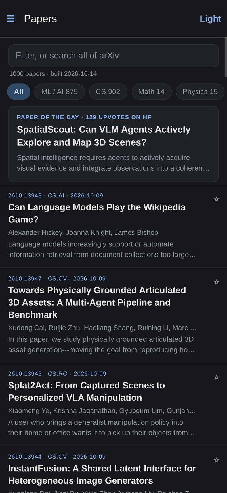
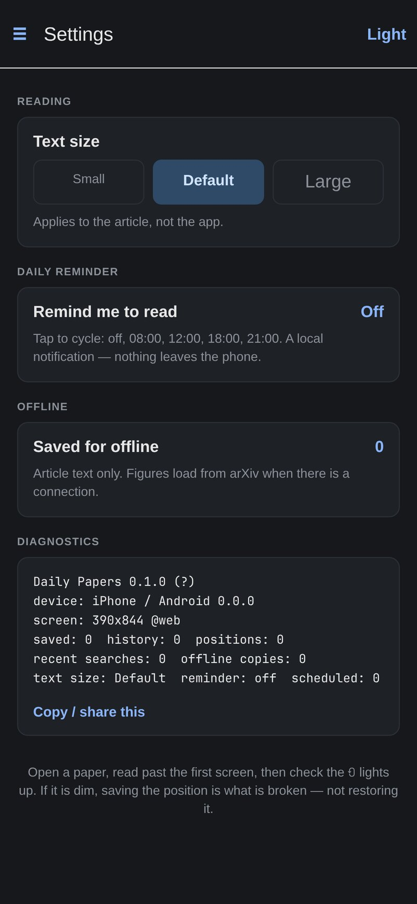

<p align="center">
  
  &nbsp;&nbsp;
  
</p>

<h1 align="center">Daily Papers</h1>

<p align="center">
  A phone-native reader for arXiv papers.<br>
  Reflowed for a 6-inch screen instead of a two-column PDF.
</p>

<p align="center">
  <a href="https://github.com/USER/REPO/releases/latest"><b>Download the Android APK →</b></a>
  &nbsp;·&nbsp;
  <a href="docs/pixel8-test-plan.md">Test plan</a>
  &nbsp;·&nbsp;
  <a href="docs/design-notes.md">Design notes</a>
</p>

---

arXiv papers are written for A4. Reading one on a phone means pinch-zooming around a page
designed for a desktop, and most tools treat mobile as an afterthought. This app reads the
paper as **reflowed text** instead — one column, comfortable measure, no sideways scrolling —
and remembers where you stopped.

96.4% of recent papers have an HTML full text that can be reflowed. The other 4% get an
in-app PDF reader.

**No backend.** Every content path is a bundled asset or a direct request from the phone to
arXiv. Nothing to deploy, nothing to pay for, nothing to go down.

## What it does

| | |
|---|---|
| **Read** | Reflowed arXiv HTML, or the PDF rendered in-app by PDF.js when there is no HTML |
| **Find** | 1,000 bundled papers, topic filters, and full-text search across all of arXiv |
| **Keep** | Save for later, reading history, finished reads, reading-position memory |
| **Offline** | Save a paper's text for a commute; figures load when there is a connection |
| **Adjust** | Text size, light/dark, a daily reminder to read |
| **Diagnose** | A settings screen that reports version, device and state, for reporting bugs |

## The parts worth reading

This is the code I'd actually point at.

**1. Reflowing someone else's HTML for a phone** — [reader/static/reader.css](reader/static/reader.css), [mobile/src/readerScript.ts](mobile/src/readerScript.ts)

arXiv ships desktop CSS with a wide measure and fixed-width layout. The reader loads arXiv's
own page and injects a replacement stylesheet **before first paint**, so the desktop layout
never flashes.

Three separate things were making the page wider than the screen. Two were LaTeXML markup
that the stylesheet didn't account for — footnote bodies rendered inline (16 of them made one
page 869px wide against a 390px viewport), and formulas LaTeXML couldn't convert. The third
was **my own rule**: I set `white-space: nowrap` on citation markers to keep `[12]` together,
not realising LaTeXML reuses that class for URLs. One bibliography entry measured 815px and,
because the page could no longer scroll sideways, was being silently *clipped* — the text was
simply gone.

**2. Reading-position memory that survives reflow** — [mobile/src/library.tsx](mobile/src/library.tsx)

A pixel offset is meaningless once the text reflows or the font size changes. A pure fraction
drifts too, because lazy-loaded figures keep growing the document after load. So a position is
`{ fraction, anchor }` where the anchor is the index of the topmost visible block.

Restore is belt-and-braces: the page retries until it stops growing, the app then *verifies
where it actually landed* and retries, and a header button does it on demand. The first
version gave up after five seconds of retrying — which sounds generous until you notice that
a page which hasn't started loading yet also has a stable height, so it was quitting before
there was anything to scroll.

**3. The cache that poisoned itself** — [mobile/src/useRepair.ts](mobile/src/useRepair.ts)

Papers saved from arXiv search were stored under their arXiv ID instead of a title. The fix
added a metadata cache — and that made it worse in an interesting way: the Saved screen renders
the same card component as everywhere else, and the card registers whatever it renders into
the cache. So a *broken* entry registered itself as the cached metadata for its own ID, and the
repair then read that back, found nothing had changed, and stopped. Two rounds of fixes failed
before I traced it. The cache now refuses to store a placeholder.

**4. Verification that runs the real thing** — [mobile/harness/](mobile/harness/)

Typechecking proves almost nothing about a reader. The harness exports the app, serves it, and
drives headless Chromium at an emulated 390×844 viewport, screenshooting every screen. A
separate harness runs the *actual* injected script against *real* arXiv HTML and measures
where the page lands — which is how the position bug above was finally caught.

It has also caught bugs in itself: a synthetic `.click()` silently did nothing on a React
Native WebView `Pressable`, so an early "test passed" was two byte-identical screenshots.

## What works, and what I haven't proven

Being precise about this is more useful than a feature list.

**Verified:** reflow at phone width with no sideways scroll across six papers and six
categories · any arXiv ID opens, old style and new · in-app PDF rendering · topic filters,
search, paper of the day · saves, history, finished reads · typecheck, tests, and a clean
`expo prebuild`.

**Not verified, because it needs a real device:** notifications, offline file storage,
the find-in-page bridge, and native WebView behaviour. The repo is set up for a week-long
test on a Pixel 8 — see [the test plan](docs/pixel8-test-plan.md). Until that runs, those
three are "written", not "working".

## How it is built

```
┌─────────────────────────── the phone ───────────────────────────┐
│  Papers ──┬── papers.json      1,000 papers, offline            │
│           ├── arXiv API        full-text search                 │
│           └── Hugging Face     paper of the day (upvotes)       │
│                       ↓                                          │
│  Reader ──┬── arxiv.org/html/{id}   + injected stylesheet        │
│           └── arxiv.org/pdf/{id}    + PDF.js in a WebView        │
│                       ↓                                          │
│  AsyncStorage: saved · history · positions · titles              │
└─────────────────────────────────────────────────────────────────┘
```

**Expo SDK 57 / React Native 0.86 / React 19 / TypeScript**, `expo-router` for navigation,
`react-native-webview` for both renderers, AsyncStorage for state. The one deliberate choice
worth explaining: a WebView *for one screen* rather than a wrapped website. The markup is
deeply nested HTML with tables and native MathML; parsing that into native components is a
large amount of work with no good answer for equations.

The PDF path is PDF.js 3.11.174 inside the same WebView — no native module, so the app still
runs in Expo Go. That works because arXiv serves PDFs with `access-control-allow-origin: *`
and supports range requests, which I checked before choosing it rather than after.

## Repository map

| Path | What it is |
|---|---|
| `mobile/` | **The app.** Screens in `app/`, logic in `src/`, verification harness in `harness/` |
| `docs/` | Design notes, the Pixel 8 test plan, and a PDF write-up |
| `dailypapers/` `ingest/` `bundle/` `recsys/` `db/` `eval/` `spike/` | The Python data pipeline behind the bundled list: crawl → enrich → embed → bundle |
| `reader/` | The reader stylesheet and extraction spike the app's CSS is generated from |
| `lab/` | Real, tested work that the app does not use: an on-device recommendation pipeline. Kept out of `mobile/` so its dependencies aren't compiled into the APK |

`mobile/tests/architecture.test.ts` enforces that boundary: it fails if a screen imports
off-path machinery, or if a relative import stops resolving.

## Running it

```bash
cd mobile
npm install
npm start          # Expo Go, or
npm run typecheck  # tsc
npm test           # architecture guard
```

To build the APK, see [docs/release.md](docs/release.md).

## Background

The original design was a static bundle with on-device recommendations — precomputed
embeddings, quantised vectors, no server. That work is real and measured: SPECTER2 turns out
to be severely anisotropic, and mean-centering improves the pairwise-similarity spread by
4.9×, which is what made recommendations viable at all. It is in `lab/` and
[docs/design-notes.md](docs/design-notes.md), switched off deliberately — with a thousand
papers from one day and no usage data, a "recommended" feed would be a guess dressed up as a
feature.

The reader came first because it is the part a person can actually judge.
